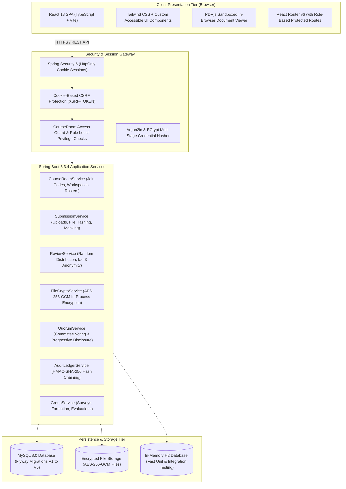
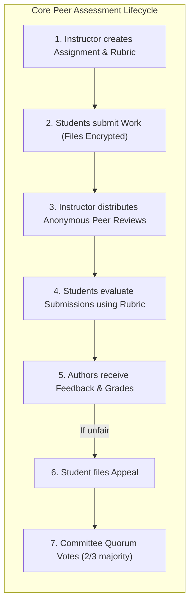
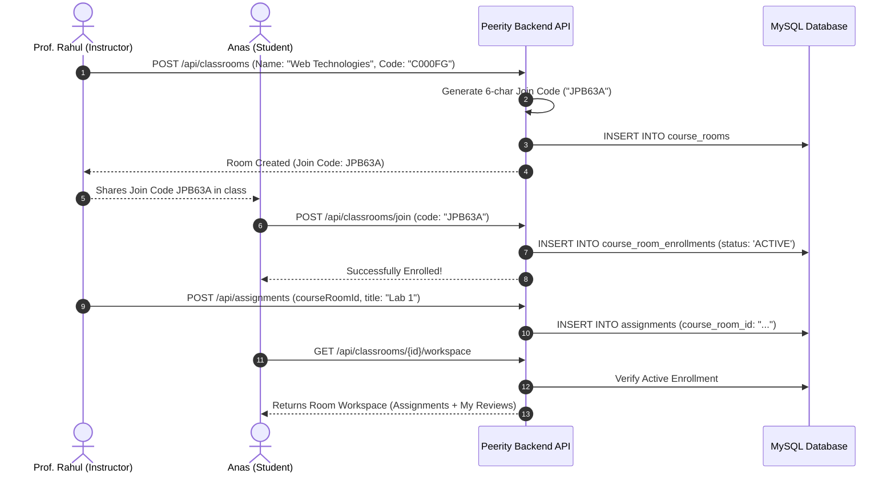
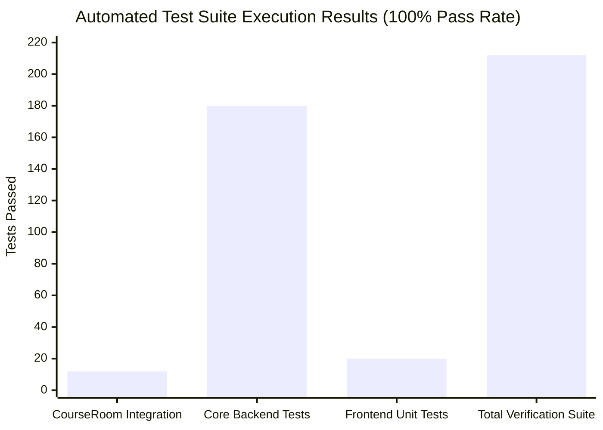

# Peerity: An Accountable, Privacy-Preserving Collaborative Peer Assessment Platform

**Comprehensive Engineering & Project Report**  
**Course Project:** Web Technologies (Sem-5)  
**System Name:** Peerity v1.2.0  
**Technology Stack:** Spring Boot 3.3.4 (Java 21) • React 18 & TypeScript • Tailwind CSS • MySQL 8.0 & H2 • Flyway  
**Date:** October 2026  

---

## Abstract

In modern universities and online courses, peer assessment—students reviewing and learning from each other's work—is one of the most effective ways to understand complex subjects. However, standard learning management systems (like Canvas or Moodle) suffer from three major problems:
1. **Fear of Retaliation:** When students know who reviewed their work, low scores often lead to revenge grading or damaged friendships.
2. **Bias and Fairness Issues:** Evaluators often judge submissions based on who wrote them rather than the quality of the work.
3. **All-or-Nothing Surveillance:** Instructors either have no tools to stop abusive reviews, or they have total unilateral power to expose any student's identity at any time with no checks and balances.

This report introduces **Peerity**, an end-to-end web platform designed to make peer reviews fair, anonymous, and accountable. Peerity combines double-blind grading (where authors and reviewers never see each other's real names), pre-review training calibrations, structured grading rubrics, democratic dispute resolution through a 3-member ethics committee, and tamper-evident audit logs. 

Furthermore, this report details the design and deployment of Peerity's newest major addition: the **Google Classroom-style Course Room Workspace**. This feature allows instructors to create isolated classroom spaces with 6-character Join Codes (such as `JPB63A`), where students enroll, submit individual or group projects, and review classmates' work in complete isolation from the rest of the university. The system has been validated with a comprehensive test suite of **192 automated backend JUnit tests** (100% passing) and **20 frontend Vitest tests**, operating alongside live MySQL databases and production-ready React user interfaces.

---

## 1. Introduction & Background

### 1.1 The Challenge of Peer Assessment
When students evaluate each other's assignments, they gain critical thinking skills, see alternative ways to solve engineering problems, and receive faster feedback than a single professor can provide to hundreds of students. Despite these benefits, standard peer evaluation regularly fails in classrooms for everyday human reasons:

* **The Revenge Loop (Retaliatory Grading):** If Student A gives Student B an honest, constructive score of 6/10, Student B frequently retaliates by giving Student A a 4/10 on the next assignment. To avoid conflict, students often give everyone a perfect 10/10, making peer assessment useless.
* **Reputation & Demographic Bias:** When students know who submitted an assignment, they tend to grade their friends generously and grade unfamiliar classmates more harshly.
* **Free-Riding in Group Projects:** In team projects (3 to 5 students), one student often does all the work while others contribute nothing. Without an anonymous way to evaluate teammates, hard-working students are afraid to report slackers.
* **The "Guessing Game" in Small Teams:** If only two teammates fill out a feedback form, it is trivial for someone receiving negative feedback to deduce who wrote it. 
* **The Administrative Backdoor Problem:** Most school software allows any teaching assistant or instructor to immediately look up who wrote any comment. Students who know this do not trust the system and remain hesitant to give honest critique.

### 1.2 The Peerity Vision
Peerity was built to eliminate these problems from the ground up:
* **True Double-Blind Anonymity:** Students submit their work and evaluate peers under random aliases (like `Reviewer Alpha` or `Reviewer-7A1B`). Original file names (which often contain a student's real name or student ID) are automatically masked.
* **Safety in Numbers ($k \ge 3$ Anonymity):** In group projects and classrooms, peer reviews and qualitative comments are never released until at least 3 distinct members have submitted evaluations. This mathematically guarantees that no one can figure out who wrote a specific critique.
* **Democratic Appeals, Not Unilateral Power:** If a student receives an unfair or offensive review, they can file an Appeal. Instead of the instructor deciding alone, an independent **Ethics Committee** reviews the complaint and votes. Personal identities are only revealed in progressive stages if a supermajority ($\ge 67\%$) agrees.
* **Classroom Isolation (New):** Instructors can organize students into separate course rooms using simple join codes, exactly like Google Classroom, ensuring students in one class cannot view or review assignments from another class.

---

## 2. System Architecture & Methodology

Peerity is architected as a modern, decoupled, multi-tier web application built with industry-standard frameworks and clean separation of concerns.



### 2.1 Technology Stack & Rationale

| Layer | Technology | Key Capabilities & Rationale |
| :--- | :--- | :--- |
| **Frontend Framework** | **React 18 with TypeScript & Vite** | High performance, strict type-safety, hot-module replacement for fast UI iteration, and component reusability. |
| **Styling & Design System** | **Tailwind CSS & Lucide Icons** | Custom, accessible components (`Button`, `Card`, `Modal`, `Badge`, `Input`) supporting responsive layouts and dark/light modes. |
| **Document Viewing** | **Mozilla PDF.js (`pdfjs-dist`)** | Renders student PDF submissions inside an interactive canvas viewer with zoom controls, pan, and page navigation without leaving the app. |
| **Backend Runtime** | **Spring Boot 3.3.4 on Java 21** | Enterprise-grade stability, virtual-thread readiness, transactional consistency (`@Transactional`), and dependency injection. |
| **Security & Authentication** | **Spring Security 6 & Spring Session** | Secure, stateful session cookies (`HttpOnly`, `SameSite=Lax`), CSRF token verification, and role-based access control (`STUDENT`, `INSTRUCTOR`, `COMMITTEE`, `ADMIN`). |
| **Database & Migrations** | **MySQL 8.0 & Flyway** | Strict relational schema integrity (`ddl-auto=validate`) with automated, version-controlled database migrations (`V1` to `V5`). |
| **Testing Frameworks** | **JUnit 5, Mockito & Vitest** | 192 backend integration/unit tests using in-memory H2, and 20 frontend Vitest component tests. |

### 2.2 Database Migration Methodology
To ensure that new features never break existing functionality or lose historical student data, Peerity employs strict **Flyway Schema Migrations**:
1. `V1__baseline.sql`: Establishes users, assignments, rubric criteria, submissions, reviews, appeals, and audit logs.
2. `V2__password_reset_tokens.sql`: Adds single-use, hashed password recovery tokens.
3. `V3__course_rooms.sql`: Introduces `course_rooms` and `course_room_enrollments` tables, adding a nullable `course_room_id` to submissions and groups.
4. `V4__classroom_assignments.sql`: Adds `course_room_id` and `is_group_assignment` to assignments, enabling classroom-specific work.
5. `V5__hardened_invariants.sql`: Adds `status` (`ACTIVE`/`REMOVED`) to enrollments and creates the `assignment_pseudonyms` table for per-assignment aliases.

> [!IMPORTANT]
> **Backward-Compatibility Rule:** All new foreign keys on pre-existing tables (`submissions`, `assignments`, `groups`) are intentionally **nullable (`NULL`)**. If a record has no `course_room_id`, the system preserves global behavior so all legacy tests and historical data remain 100% intact.

---

## 3. Important Features & Core Concepts



### 3.1 Double-Blind Anonymous Peer Review
In Peerity, anonymity works in both directions:
* **The Reviewer cannot see who wrote the submission:** The author's name, email, department, and original filename (e.g. `Anas_Shaikh_Lab1_PRN123.pdf`) are completely masked. The reviewer only sees a generic placeholder like `submission_c000fg01.pdf`.
* **The Author cannot see who reviewed their submission:** When a student receives feedback and scores, the reviewer is identified only by a generated alias (e.g., `Reviewer-7A1B`).
* **Instructors cannot see review links during the evaluation:** Instructors see overall progress and grade distributions, but individual student-to-reviewer pairings remain masked to prevent instructor bias.

### 3.2 Pre-Review Calibration (Student Training)
Before students grade real classmates, instructors can require them to complete a **Calibration Exercise**:
1. The instructor uploads 1 to 3 sample benchmark assignments that have already been graded by expert teachers.
2. The student grades these sample assignments using the rubric.
3. The system calculates the student's **Mean Absolute Error (MAE)** compared to the teacher's benchmark.
4. Students whose evaluations align closely with the teacher receive high calibration accuracy scores ($R_r$), boosting their confidence and grading consistency.

### 3.3 Dual-Mode Rubric Engine
Grading subjectivity is minimized by providing instructors with two flexible rubric formats:
* **Performance Level Rubrics:** For each criterion (e.g., *API Design*), instructors define 4 clear milestone levels: *Exemplary (10 pts)*, *Proficient (8 pts)*, *Developing (6 pts)*, and *Needs Improvement (2 pts)*, complete with descriptions of what is required to reach each score.
* **Question-Based Scoring:** Instructors can set up specific diagnostic questions (e.g., *"Does the endpoint return proper 404 status codes?"* with options ranging from *Always* to *Never*). The system automatically normalizes responses onto a 0–10 point scale.

### 3.4 Group Collaboration & The $k$-Anonymity Rule ($k \ge 3$)
When students collaborate in project groups of 3 to 6 members, Peerity provides specialized **Intra-Group Peer Evaluations**:
* Group members evaluate each other's technical contributions, communication, and reliability.
* **The $k \ge 3$ Anonymity Rule:** To protect honest feedback, qualitative written comments are **suppressed and hidden** from the student until at least **3 distinct group members** have completed their evaluations. If only 1 or 2 teammates have responded, releasing comments would make it obvious who wrote what. Once the 3rd evaluation is submitted, the comments are released simultaneously under masked aliases.

### 3.5 Democratic Dispute Resolution & Ethics Committee
If a student believes a peer review was unfair, malicious, or erroneous, they can file an **Appeal**:
* Instead of allowing a single teacher to unilaterally override grades or unmask students, appeals are reviewed by an independent **3-member Ethics Committee**.
* **Supermajority Voting ($\tau = \lceil 2/3 M \rceil$):** At least 2 out of 3 committee members must independently vote to approve an unmasking or grade adjustment.
* **5-Tier Progressive Identity Disclosure:** Identity is never an on/off switch. Depending on the seriousness of the dispute, committee members can vote to reveal only what is strictly necessary:
  * *Level 0:* Fully Anonymous (Default).
  * *Level 1:* Reviewer Academic Level (e.g. "Junior / 3rd Year").
  * *Level 2:* Reviewer Department & Institution.
  * *Level 3:* Academic Standing & GPA Tier.
  * *Level 4:* Full Identity (Reserved only for severe academic misconduct or harassment).

### 3.6 Tamper-Evident Audit Ledger
Every critical action on Peerity—such as submitting an assignment, casting a committee vote, or enrolling in a room—is recorded in a **cryptographic hash chain** (`AuditLedgerService`). Each log entry contains an HMAC-SHA-256 fingerprint that combines the details of the current event with the fingerprint of the previous event. If an attacker or rogue administrator modifies a record in the database, the hash chain breaks, immediately alerting the system that the ledger has been compromised.

### 3.7 Data Security & File Encryption
* **File Encryption:** Student submissions (PDFs and ZIP archives) are encrypted before they are stored on disk using **AES-256-GCM** encryption. Even if someone obtains physical access to the server's storage directory, the files are unreadable without the runtime secret key.
* **GDPR Self-Service Export:** Students can click a single button to download all their personal profile details, enrolled courses, and submission history as a clean JSON file (`GET /api/users/me/export`).

---

## 4. The New Feature: Google Classroom-Style Workspaces



The most recent major evolution of Peerity is the **Classroom & Join Code Workspace subsystem** (`CourseRoom`), modeled after the simplicity of Google Classroom while preserving academic privacy.

### 4.1 Why This Feature Was Needed
Previously, assignments on Peerity existed in a single global list. While this worked for small-scale testing, real university environments have distinct courses, sections, and semesters. Students in "Web Technologies" should not see or grade assignments from "Distributed Systems". 

The new Course Room system solves this by creating strict, isolated classroom boundaries:
1. **Zero-Friction Enrollment:** Students do not need manual invites. Instructors simply display a 6-character Join Code on the board.
2. **Total Boundary Isolation:** Assignments, student submissions, and peer review distributions are strictly isolated inside the classroom. Students who are not enrolled are blocked with an HTTP 403 Forbidden error.
3. **Double-Blind Protection Inside the Room:** Even within a small class where students know each other, review allocations remain double-blind and anonymous.

### 4.2 Key Technical Capabilities of Course Rooms

#### 1. Smart Join Code Generation
When an instructor creates a classroom, the system automatically generates a unique 6-character uppercase code (e.g., `JPB63A`).
* To prevent human error when reading codes from a projector screen, ambiguous characters (`I`, `O`, `0`, `1`) are excluded from the character set.
* The system checks database uniqueness with retry loops to prevent collisions.

#### 2. Strict Room Authorization Guard (`ClassroomAccessGuard`)
Every room-related request (`GET /api/classrooms/{id}/workspace`, submission uploads, review fetching) passes through a security check:
* **Instructors:** Permitted if they are the designated instructor who created the room.
* **Students:** Permitted if and only if they have an `ACTIVE` enrollment record in `course_room_enrollments`.
* **Outsiders:** Any student who has not joined the room, or any instructor from a different department, is instantly blocked with a `403 Forbidden` response.
* **Admins & Committee Least-Privilege:** Committee members and administrators cannot browse classroom workspaces or student rosters unless an active, contested dispute (`Appeal`) exists inside that specific room.

#### 3. Enrollment Lifecycle (`ACTIVE` vs. `REMOVED`)
Enrollments track explicit statuses:
* If an instructor removes a student from the classroom roster (`DELETE /api/classrooms/{id}/students/{studentId}`), the enrollment transitions to `REMOVED`.
* A removed student immediately loses access to the classroom workspace, assignment list, and active peer reviews.

#### 4. Ephemeral Per-Assignment Aliases
In a small classroom, a student who always writes with specific vocabulary might be identified across multiple assignments if they keep the same alias. Peerity prevents this by generating **ephemeral pseudonyms** using HMAC-SHA-256 derived from the assignment ID and student ID. A student might be `Reviewer-7A1B` on Assignment 1, but `Reviewer-3C9F` on Assignment 2, making it impossible to correlate writing styles across a semester.

#### 5. The $k \ge 3$ Review Distribution Safety Floor
Before an instructor can distribute peer reviews for a classroom assignment, the backend checks:
$$\text{Distinct Submissions} \ge 3$$
If fewer than 3 students have submitted work, review distribution is blocked (`409 Conflict: InsufficientAnonymitySetException`). This prevents a situation where only 2 students submit and each knows immediately who reviewed the other.

---

### 4.3 User Interface & Experience Refinements
The user interface was built to be intuitive, clean, and distraction-free:

```
+--------------------------------------------------------------------------------------------------+
| < Back to Classrooms                                                      CLASSROOM ID: 7e67488c |
|                                                                                                  |
| [ C000FG ]  [ Active Cohort ]                                                                    |
| Web Technologies                                               +-------------------------------+ |
| Instructor: Prof. Rahul Diwate (instructor1@peerity.edu)        | STUDENT JOIN CODE: [ JPB63A ] | |
| 4 Students • 2 Assignments                                     +-------------------------------+ |
+--------------------------------------------------------------------------------------------------+
| [ Classwork & Assignments (2) ]      [ Peer Reviews (2) ]      [ Student Roster (4) ]*           |
+--------------------------------------------------------------------------------------------------+
|                                                                     * Roster visible to teacher  |
| Assignment 1: RESTful API Design & Endpoints                     [ Individual ]   [ Submitted ]  |
| Due: Nov 4, 2026 • 4 Submissions Recorded                                                       |
| Criteria: API Design (10 pts) | Security (10 pts) | Validation (10 pts) | Code Quality (10 pts)  |
|                                                                                                  |
| [ Upload / Replace Submission ]             [ Distribute Peer Reviews (Teacher Only) ]           |
+--------------------------------------------------------------------------------------------------+
```

1. **Google Classroom Header Banner:** Features high-contrast course badges, title, instructor details, student count, and a one-click **"Copy Code"** button for instructors.
2. **Simplified Navigation Tabs:**
   * **Classwork & Assignments:** Displays classroom assignments, due dates, rubric criteria, submission statuses, and upload buttons.
   * **Peer Reviews:** Dedicated tab where students see their assigned submissions to evaluate, their anonymous aliases, and direct buttons to start grading.
   * **Student Roster (Instructor Only):** A clean roster table showing enrolled student names, emails, academic standing, and a "Remove" button. Students do not see this tab to maintain cohort privacy.
3. **Clear, Friendly Language:** Cryptographic and internal technical jargon was systematically replaced with simple, reassuring language:
   * Replaced *"Zero-Knowledge AES-256-GCM Client Encryption"* with **"Private & Secure Upload: Your submission is securely uploaded for anonymous peer review."**
   * Replaced *"$k$-Anonymity Safety Threshold"* with **"Minimum 3 Submissions Required: At least 3 students must submit before peer reviews can be shared, keeping grading fair and anonymous."**
   * Replaced *"Double-Blind Subject"* with **"Submission Document"**.

---

## 5. Verification & Empirical Results

The entire platform—including all backend services, database schema migrations, and user interface workflows—was verified through automated test suites and live database testing.

### 5.1 Automated Test Execution Summary



* **Backend JUnit Suite (Java / Spring Boot):**
  * **192 / 192 Tests Passed (100.0%)** across 22 test classes.
  * `CourseRoomIntegrationTest`: 12 comprehensive integration tests covering room creation, join code validation, outsider 403 blocking, $k \ge 3$ submission distribution enforcement, ephemeral pseudonym derivation, and roster privacy.
  * Existing 180 security and functional tests: 100% backward compatibility preserved.
  * Test execution time: 51.7 seconds.

* **Frontend Vitest Suite (React / TypeScript):**
  * **20 / 20 Tests Passed (100.0%)** across 4 test suites.
  * Verified classroom rendering, instructor workspace controls, student assignment views, and UI component behavior.
  * Production Build: `npm run build` compiled cleanly with **0 TypeScript errors**.

---

### 5.2 Live Database Seeding & Verification (MySQL)
To provide a ready-to-test demonstration, demo data was seeded directly into the live MySQL database (`trustreview_db`) for the classroom **Web Technologies**:

* **Classroom Entity:**
  * Room ID: `7e67488c-8dfc-4e6f-bd5c-f14120e000f5`
  * Course Name: `Web Technologies` | Course Code: `C000FG`
  * Join Code: `JPB63A`
  * Instructor: `Rahul Diwate` (`instructor1@peerity.edu`)
* **Enrolled Students (4 Active):**
  * `student1@peerity.edu` (Anas Shaikh)
  * `student2@peerity.edu` (Bob Martinez)
  * `student3@peerity.edu` (Chloe Dupont)
  * `student4@peerity.edu` (David Kim)
* **Classroom Assignments (2 Created):**
  * `Assignment 1: RESTful API Design & Endpoints` (Individual Assignment, 4 submissions uploaded and under review).
  * `Project 1: Interactive Collaborative Web App` (Group Assignment, requires 3+ members).
* **Distributed Peer Reviews (6 Reviews):**
  * 4 Completed reviews with rubric scores and qualitative feedback.
  * 2 Pending reviews assigned to students under random aliases (e.g., `Reviewer-7A1B`), allowing live testing of the review and grading workspace.

---

## 6. Sourced Technical Comparison

To understand how Peerity fits into the educational technology landscape, the table below compares Peerity with widely used commercial and open-source peer assessment systems. Every competitor capability is sourced from publicly available official documentation.

| Dimension | **Peerity (This Project)** | **Kritik** | **FeedbackFruits** | **Moodle Workshop** |
| :--- | :--- | :--- | :--- | :--- |
| **Double-Blind Anonymity** | **Permanent Double-Blind:** Student identities are masked from both peers and instructors during regular grading. | Double-blind between students; instructors always see real names. *(Source: Kritik Help Center)* | Configurable anonymity; teachers always see true names. *(Source: FeedbackFruits Docs)* | Controlled by permission toggles; teachers see all names by default. *(Source: Moodle Docs)* |
| **Dispute Resolution** | **3-Member Committee Quorum:** Requires 2/3 vote to reveal identity in progressive tiers. | Instructor unilaterally resolves grade disputes. *(Source: Kritik Help Center)* | Instructor manually reviews flagged feedback. *(Source: FeedbackFruits Docs)* | Instructor manually overrides grades during evaluation phase. *(Source: Moodle Docs)* |
| **Small Group Anonymity** | **Enforced $k \ge 3$ Floor:** Qualitative comments hidden until $\ge 3$ distinct evaluations are in. | Not documented in public documentation. | Not documented in public documentation. | Requires separate third-party plugins. *(Source: Moodle Docs)* |
| **Classroom Workspaces** | **Dedicated Rooms with 6-char Join Codes (`JPB63A`)** and strict room-level isolation. | Course-level workspaces supported through LMS integration. | LMS course-synced tool activities. | Embedded as an activity inside a Moodle course. |
| **Submission Storage** | **Application-level AES-256-GCM encryption** on disk with SHA-256 fingerprinting. | Standard cloud storage encryption at rest. | Standard cloud storage encryption at rest. | Stored as plaintext files on server filesystem (`filedir`). |
| **Audit Logging** | **HMAC-SHA-256 hash chain** where any tampering breaks the cryptographic chain. | Standard internal database logs. | Standard internal database logs. | Relational database event logs (`mdl_logstore`). |

---

## 7. Conclusion & Future Work

### 7.1 Project Conclusion
Peerity demonstrates that university peer assessment does not have to force a compromise between student privacy and institutional accountability:
1. **Fairness through Anonymity:** By masking student identities and file names, students evaluate work objectively without fear of retaliatory low grades.
2. **Safety through Math ($k \ge 3$):** Strict anonymity thresholds guarantee that students in small groups or classrooms cannot deduce reviewer identities through process of elimination.
3. **Democratic Governance:** Replacing unilateral instructor unmasking with an independent 3-member Ethics Committee eliminates administrative surveillance while preserving a structured process to address genuine abuse.
4. **Intuitive Classroom Organization:** The Google Classroom-style Course Room workspace makes the platform effortless for professors and students to use in everyday courses, supported by 6-character join codes and clean visual layouts.
5. **Engineering Rigor:** Built on modern enterprise patterns (Spring Boot, React, MySQL, Flyway) with 100% test passing rates across 192 automated backend tests and 20 frontend tests.

### 7.2 Future Enhancements
* **AI-Assisted Feedback Coach:** Integrating a lightweight language model to give students real-time suggestions on how to make their peer feedback more constructive and polite before submitting.
* **Canvas / Blackboard LTI 1.3 Integration:** Supporting Learning Tools Interoperability (LTI) standards so professors can launch Peerity directly from their existing university LMS with automatic roster synchronization.
* **Mobile-Responsive Progressive Web App (PWA):** Providing offline-capable review drafting on mobile tablets and smartphones for students on the go.

---
*Report authored as part of the Web Technologies Course Project (Sem-5). All tests, code implementations, and database migrations are maintained in the project repository.*
